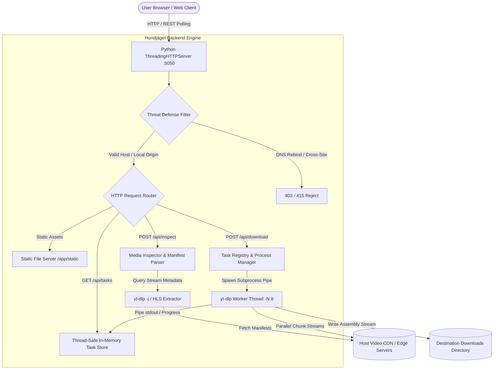

# Hundjäger Media Hub
**Apex Video Stream Inspector & Resilient Multi-Format Media Extractor**

[](https://python.org)
[](https://docs.python.org/3/library/)
[](.github/workflows/ci.yml)
[](https://github.com/yt-dlp/yt-dlp)
[](LICENSE)

> A high-performance, zero-external-dependency local media extraction engine and dark-glassmorphism cockpit built to inspect complex web media streams, parse fragmented HLS manifests, eliminate CDN timeout dropouts, and orchestrate concurrent downloads.

---

## 🌟 Key Engineering Highlights

- **Zero-External-Dependency Backend**: The entire server runs on Python's native standard library (`http.server.ThreadingHTTPServer`, `subprocess`, `urllib`, `threading`, `argparse`). Zero framework overhead, zero package bloat, sub-15MB idle memory footprint.
- **Threat-Modeled IPC Defense**: Built-in protection against local drive-by CSRF and DNS-rebinding attacks. Validates the `Host` header, enforces `Content-Type: application/json` on all state-mutating endpoints, verifies caller `Origin`, and rejects cross-site requests via modern `Sec-Fetch-Site` inspection.
- **Resilient HLS Stream Handling**: Resolves segmented `.m3u8` HLS streaming manifests, bypassing CDN rate limiting and dropped packets through parallel fragment downloading (`-N 8`), extended socket timeouts (`--socket-timeout 20`), and exponential retry heuristics.
- **Dynamic Bitrate & Stream Size Estimation**: Accurately computes or estimates payload sizes using stream bitrate headers (`tbr`, `vbr`, `abr`) and resolution profile heuristics when edge servers conceal `Content-Length`.
- **Real-Time Subprocess Pipe Streaming**: Wraps `yt-dlp` child processes asynchronously with non-blocking stdout stream parsing, extracting live transfer speeds, ETAs, and completion percentages for frontend hydration.
- **Bounded LRU Task Storage**: Thread-safe in-memory task registry protected with mutex locks, featuring automated LRU eviction of old tasks to prevent unbounded memory growth.
- **Cross-Platform Compatibility**: Native platform detection for macOS (`open`), Linux (`xdg-open`), and Windows (`os.startfile`) when launching the downloads folder.
- **Glassmorphic Cyber-Cockpit UI**: Handcrafted Vanilla CSS design system featuring ambient glow effects, responsive card grids, resolution badges, active task monitors, and micro-animations.

---

## 🏛️ System Architecture



---

## 🚀 Quick Start

### Prerequisites
- **Python 3.10+**
- **yt-dlp** and **ffmpeg** (installed via package manager)
  ```bash
  # macOS
  brew install yt-dlp ffmpeg

  # Linux (Debian/Ubuntu)
  sudo apt update && sudo apt install -y ffmpeg yt-dlp
  ```

### Local Execution
1. Clone the repository:
   ```bash
   git clone https://github.com/DevHacksHitman/hundjager.git
   cd hundjager
   ```
2. Start the local server:
   ```bash
   python3 app/server.py
   ```
   *Optional CLI Arguments:*
   ```bash
   # Custom host, port, or downloads directory
   python3 app/server.py --host 127.0.0.1 --port 5050 --downloads-dir ~/Downloads

   # Exposing beyond loopback requires explicit Host opt-in (otherwise 403)
   python3 app/server.py --host 0.0.0.0 --allow-hosts myhost.lan,0.0.0.0
   ```
3. Open your browser and navigate to:
   ```text
   http://127.0.0.1:5050
   ```

### Docker Execution
Run instantly in a container with `yt-dlp` and `ffmpeg` pre-configured:
```bash
docker compose up -d
```

---

## 📡 REST API Reference

All state-mutating (`POST`) endpoints enforce `Content-Type: application/json` and validate local caller identity:

| Endpoint | Method | Payload / Params | Description |
| :--- | :--- | :--- | :--- |
| `/api/inspect` | `POST` | `{"url": "https://..."}` | Fetches metadata, stream resolutions, codecs, and computed byte estimates. |
| `/api/download` | `POST` | `{"url": "...", "format_id": "...", "resolution": "..."}` | Spawns a background worker to extract and assemble video fragments. |
| `/api/tasks` | `GET` | *None* | Returns real-time status, progress %, download speed, and ETA of all tasks. |
| `/api/tasks/retry` | `POST` | `{"task_id": "..."}` | Retries an individual failed or cancelled task. |
| `/api/tasks/retry-all` | `POST` | *None* | Retries all failed and cancelled tasks in parallel. |
| `/api/tasks/delete` | `POST` | `{"task_id": "..."}` | Terminates and deletes a specific task from memory. |
| `/api/tasks/clear` | `POST` | `{"mode": "finished" \| "all"}` | Clears finished/cancelled tasks or all tasks. |
| `/api/cancel` | `POST` | `{"task_id": "..."}` | Signals graceful termination and cleanup of the target subprocess. |
| `/api/open-downloads` | `POST` | *None* | Opens the local destination directory in Finder (macOS), File Manager (Linux), or Explorer (Windows). |
| `/api/status` | `GET` | *None* | Returns health status, detected `yt-dlp` binary path, and active downloads folder. |

---

## 🧪 Testing

Hundjäger includes a zero-dependency test suite covering metric formatting, stream size estimation, format selector resolution, LRU task storage limits, and threat-modeled security defenses:

```bash
python3 -m unittest discover -s tests -p "test_*.py" -v
```

---

## 📂 Repository File Structure

```text
Hundjäger/
├── README.md                  # Flagship documentation & architecture guide
├── LICENSE                    # MIT License
├── Dockerfile                 # Multi-stage container definition
├── docker-compose.yml         # 1-command container orchestration
├── .gitignore                 # Production ignore rules
├── .github/
│   └── workflows/
│       └── ci.yml             # Multi-version Python CI pipeline
├── app/
│   ├── server.py              # Zero-dep HTTP server, security filters, yt-dlp pipe
│   └── static/
│       ├── index.html         # Cockpit layout & markup
│       ├── style.css          # Dark-luxe glassmorphism styling & tokens
│       └── app.js             # Reactive client logic, inspection & polling
└── tests/
    └── test_server.py         # Unit, integration, and security test suite
```

---

## 🛡️ License

This project is licensed under the [MIT License](LICENSE).
